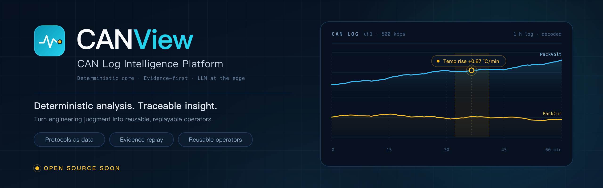
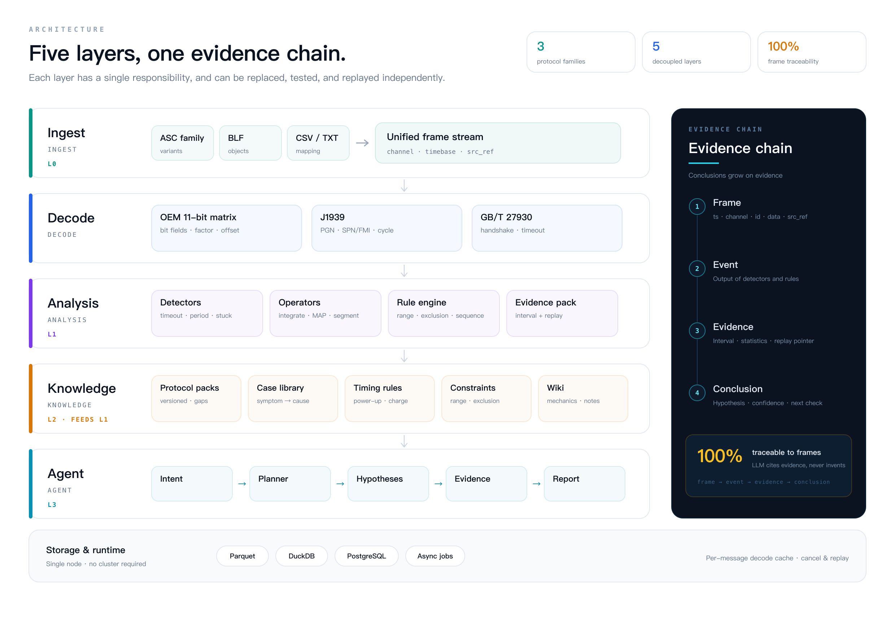
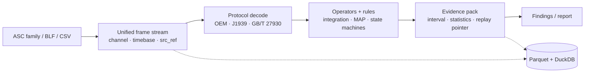
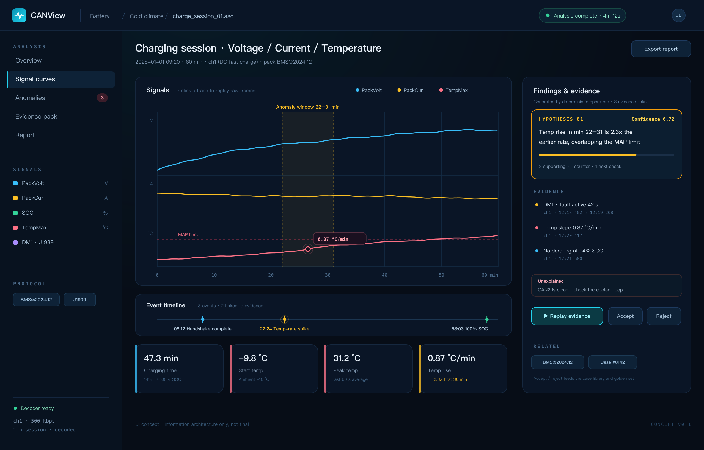

<p align="center">
  
</p>

<h1 align="center">CANView</h1>

<p align="center"><strong>See the signal. Understand the fault.</strong></p>

<p align="center">
An evidence-first CAN log analysis platform for vehicles and battery systems.
</p>

<p align="center">
  <strong>English</strong> · <a href="README.zh-CN.md">简体中文</a>
</p>

<p align="center">
  <a href="#opensource"></a>
  <a href="#architecture"></a>
  <a href="#protocols"></a>
  <a href="#opensource"></a>
</p>

<p align="center">
  <a href="#overview">Overview</a> ·
  <a href="#features">Features</a> ·
  <a href="#architecture">Architecture</a> ·
  <a href="#protocols">Protocols</a> ·
  <a href="#analysis">Analysis</a> ·
  <a href="#evidence">Evidence</a> ·
  <a href="#llm">LLM</a> ·
  <a href="#ui">UI</a> ·
  <a href="#scale">Scale</a> ·
  <a href="#roadmap">Roadmap</a> ·
  <a href="#opensource"><strong>Open source</strong></a>
</p>

> **CANView** turns multi-hour CAN / CAN FD logs into traceable findings. Deterministic operators and rule engines compute the results; an LLM orchestrates workflows and explains them. Every conclusion links back to the frames that support it.

---

<a id="overview"></a>

## Overview

CANView is a web-based analysis platform for CAN and CAN FD logs from vehicles and battery systems. It ingests ASC, BLF, and CSV logs; decodes OEM matrices, J1939, and GB/T 27930 traffic; runs detectors and compute operators; and produces an evidence pack plus a human-readable report.

It is built for powertrain and battery engineers who need to find the signal, prove the cause, and hand off a conclusion that a colleague can replay frame by frame.

### Highlights

- **Evidence-first.** Every finding carries a frame interval, a replay pointer, and a confidence note.
- **Deterministic core.** Operators and rules compute. The LLM plans, routes, and explains — it never changes a number.
- **Protocol as data.** Versioned protocol packs drive decoding; import produces a gap report instead of silently dropping signals.
- **Three protocol families.** OEM 11-bit matrices, J1939 (PGN / SPN / FMI), and GB/T 27930 charging.
- **Two analysis modes.** One-click standard procedures for common questions; conversational analysis for long-tail exploration.
- **Built for large logs.** Streaming decode, lazy materialization, and viewport-aware rendering.

---

<a id="features"></a>

## Features

CANView targets six recurring analysis jobs across diagnosis, computation, and validation.

| # | Capability | Input | Output | Depends on |
|---|---|---|---|---|
| 1 | Fault signal localization | Drive or charging log | Fault signal list + repair guidance | DM1 / SPN dictionary, vendor PGNs, case library |
| 2 | Static data compliance check | Stationary vehicle log | Anomaly list + compliance report | Signal ranges, exclusion rules |
| 3 | Energy, MAP, and capacity | Voltage / current / SOC log | Charge and energy totals, MAP deviation, capacity by temperature | Physical signals, calibration MAP |
| 4 | Charging session metrics | Charging log | Duration, temperature rise, start / peak temperature | Current and temperature signals |
| 5 | Power-up sequence diagnosis | Power-up log | Root cause + abnormal signal path | Power-up state machine |
| 6 | Charging sequence diagnosis | Charging log | Root cause + handshake failure point | GB/T 27930 state machine |

> These are the target capabilities for the first open-source release. Items that need physical signals or calibration data depend on a complete protocol pack; CANView surfaces those gaps at import time instead of failing later.
>
> MAP refers to the calibration table of temperature × SOC → allowed current.

---

<a id="architecture"></a>

## Architecture

<p align="center">
  <a href="assets/architecture.png"></a>
</p>

Five layers and one evidence chain. Data flows down; knowledge feeds analysis. Every layer can be replaced, tested, and replayed independently.



| Layer | Responsibility |
|---|---|
| **Ingest** | ASC family / BLF / CSV → unified frame stream with channel, timebase, and source position |
| **Decode** | OEM 11-bit matrices, J1939, GB/T 27930 |
| **Analysis** | Detectors, compute operators, rule engine, evidence pack |
| **Knowledge** | Protocol packs, case library, timing rules, signal constraints, wiki |
| **Agent** | Intent → flow → hypotheses → evidence → report |
| **Storage** | Parquet + DuckDB + PostgreSQL, with per-message decode caching |

### Frame model

```text
Frame {
  ts_ns, channel, can_id, ide, type, dlc, data[64],
  network_id,                 // channel → network: vehicle CAN / charging CAN / J1939
  src_ref { file, offset }    // required for traceability
}
```

`channel` is part of the identity of a frame, not an optional column: the same arbitration ID can appear on multiple channels, and ASC and BLF files use different channel-numbering conventions.

### Operators

Operators are reusable analysis units with declared inputs, outputs, version, and confidence conditions.

```yaml
- op: calc.coulomb_integration
  params:
    current: BMS_PackCur
    dt_ms: 10
    polarity: charge_positive
    zero_drift_correction: true
  output: { charge_Ah, energy_kWh, soc_delta, confidence }
```

An operator can mark a result as unreliable — for example when current samples are missing inside the integration window — so downstream rules and reports can treat it accordingly.

---

<a id="protocols"></a>

## Protocol layer

CANView treats protocols as versioned data, not code branches.

| Family | Encoding | Typical traffic |
|---|---|---|
| **OEM 11-bit** | Bit fields, factor and offset | Body, BMS, and vehicle-specific matrices |
| **J1939** | PGN + SPN / FMI, broadcast cycles | Commercial-vehicle powertrain |
| **GB/T 27930** | Handshake state machine and timeouts | DC charging |

A **protocol pack** bundles message definitions, signal definitions, units, ranges, cycle times, and version metadata. When a matrix or DBC is imported, CANView produces the pack and a gap report:

- messages without headers;
- signals without a parent message;
- overlapping bit ranges;
- signals with no physical range;
- unsupported multiplexing.

Logs are bound to a pack version, vehicle or configuration, and effective date. If the wrong version is used, the decoded values can look plausible while being wrong — the binding makes that visible.

---

<a id="analysis"></a>

## Analysis engine

| Component | What it does | Examples |
|---|---|---|
| **Detectors** | Find communication and signal anomalies | Timeout, period deviation, missing frames, range violation, stuck signal |
| **Operators** | Compute engineering quantities | Coulomb integration, MAP comparison, capacity by temperature segment, statistics, correlation |
| **Rules** | Validate values, combinations, and sequence | Value ranges, mutual exclusion, power-up state machine, charging handshake |
| **Evidence** | Package findings for review | Time interval, statistics, raw-frame pointer, confidence |

Detectors and operators are deterministic: the same input and parameters produce the same output. Rules are declarative, so a new vehicle or scenario can be added without changing the execution engine.

---

<a id="evidence"></a>

## Evidence model

```text
Frame ──▶ Event ──▶ Evidence ──▶ Conclusion
  │          │           │            │
  ts/ch/id   detector    interval     hypothesis
  data       /rule       statistics   confidence
  src_ref                replay ptr   next check
```

Every level keeps a pointer to the level below it. A conclusion can be replayed to the original frame without re-running the LLM, and a report can show exactly which frames support — or contradict — a hypothesis.

---

<a id="llm"></a>

## LLM layer

The model is an orchestrator and technical writer, not a calculator.

- **Model registry.** Each model is registered with provider, context window, capabilities, cost, and quota; tasks are routed by capability.
- **Flow compilation.** A natural-language question becomes a reviewable flow YAML: which signals to decode, which operators to run, which MAP to compare against, and what time window to use.
- **Guardrails.** Generated flows must pass schema validation and a short dry run on a slice before they can execute on the full log.
- **Reproducibility.** Runs record model ID, prompt version, retrieval snapshot, and temperature, so a conclusion can be regenerated or audited.

The LLM can cite evidence, rank hypotheses, and write the report. It cannot modify computed numbers.

---

<a id="ui"></a>

## Web experience

<p align="center">
  <a href="assets/ui-concept.png"></a>
</p>

<p align="center"><sub>UI concept · information architecture only, not final implementation</sub></p>

- **View.** Signal traces and the event timeline share one timebase; anomaly windows are computed, not drawn by hand.
- **Prove.** Every evidence item carries a channel and time pointer; clicking it replays the original frames.
- **Record.** Accepting or rejecting a finding feeds the case library and the golden set used for evaluation.

---

<a id="scale"></a>

## Scale & deployment

CANView is single-node by design: no cluster, no external stream processor.

- **Streaming ingest.** Logs are decoded as a stream rather than loaded into memory as a whole.
- **Lazy materialization.** Only signals used by the analysis, or requested by the viewport, are materialized.
- **Columnar cache.** Decoded results are stored per message in Parquet and queried through DuckDB.
- **Viewport-aware rendering.** Large traces are downsampled on the server and rendered only for the visible window.
- **CAN FD path.** A native kernel adapter is planned for CAN FD and multi-GB logs; the frame model and storage layout do not change.

---

<a id="roadmap"></a>

## Roadmap

| Phase | Scope |
|---|---|
| **M0 — Baseline** | Format, protocol, and performance baselines on real logs |
| **M1 — Core loop** | Frame model, decode, operators, detectors, evidence pack, CLI |
| **M2 — Knowledge** | Protocol gap reports, case library, guided rule authoring |
| **M3 — Web** | Upload, job queue, trace viewer, report export, role-based access |
| **Open source** | Code cleanup, sanitized samples, docs, CI |

---

## Acknowledgements

- [python-can](https://github.com/hardbyte/python-can) — format parsing reference and compatibility baseline.
- [DuckDB](https://duckdb.org/) and [Apache Parquet](https://parquet.apache.org/) — single-node analytical storage.
- SAE J1939 and GB/T 27930 — the two most reusable public knowledge bases for commercial vehicles and charging.

---

<a id="opensource"></a>

## Open source

**CANView will be open sourced soon.** We are finishing code cleanup, sanitization, and documentation.

### License

Apache-2.0 (planned). Protocol packs and sample data will have separate terms.

### Stay in the loop

- **Star** this repository — the release will be announced here and in Releases.
- **Watch** → Custom → Releases to receive release notifications only.
- Open an [issue](../../issues) or [discussion](../../discussions) if you have a scenario or a protocol you would like to see supported.

---

<p align="center">
  <b>CANView will be open sourced soon.</b><br/>
  <sub>Star the repository to get the first release.</sub>
</p>
