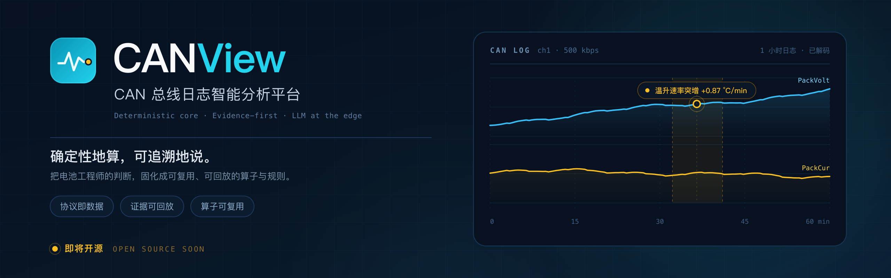
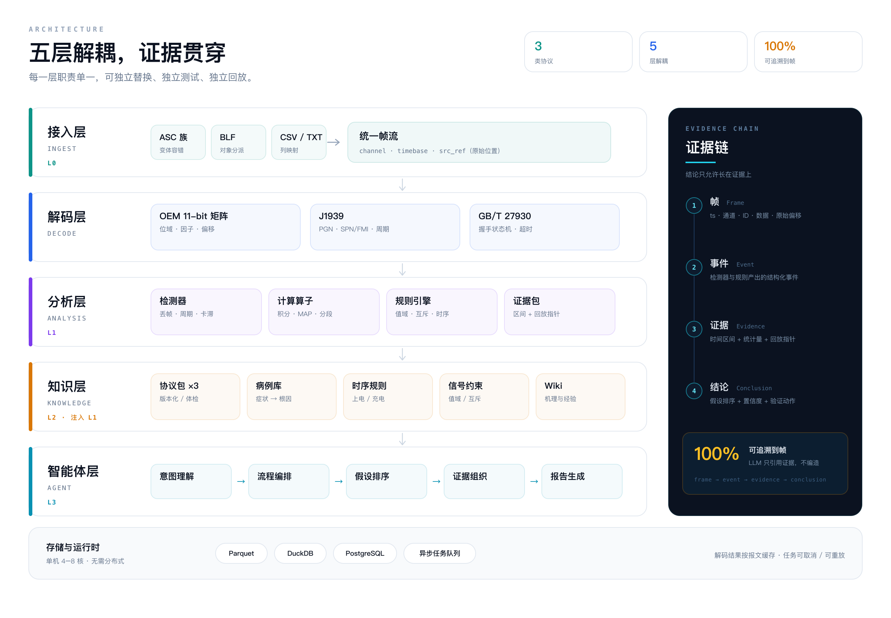
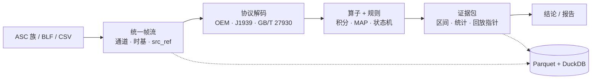
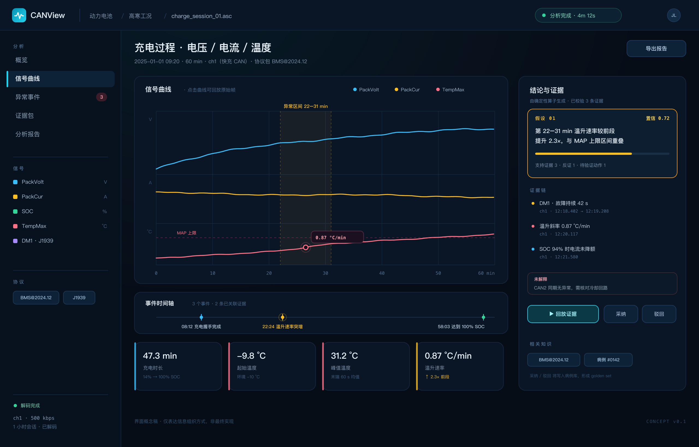

<p align="center">
  
</p>

<h1 align="center">CANView</h1>

<p align="center"><strong>看得见信号，读得懂故障。</strong></p>

<p align="center">
面向整车与动力电池的证据优先型 CAN 日志分析平台。
</p>

<p align="center">
  <a href="README.md">English</a> · <strong>简体中文</strong>
</p>

<p align="center">
  <a href="#opensource"></a>
  <a href="#architecture"></a>
  <a href="#protocols"></a>
  <a href="#opensource"></a>
</p>

<p align="center">
  <a href="#overview">概览</a> ·
  <a href="#features">功能</a> ·
  <a href="#architecture">架构</a> ·
  <a href="#protocols">协议</a> ·
  <a href="#analysis">分析</a> ·
  <a href="#evidence">证据</a> ·
  <a href="#llm">模型</a> ·
  <a href="#ui">界面</a> ·
  <a href="#scale">规模</a> ·
  <a href="#roadmap">路线图</a> ·
  <a href="#opensource"><strong>即将开源</strong></a>
</p>

> **CANView** 把多小时的 CAN / CAN FD 日志变成可追溯的结论。确定性算子与规则负责计算，模型负责编排流程与解释结果；每条结论都能回放到支撑它的原始帧。

---

<a id="overview"></a>

## 概览

CANView 是一个面向整车与动力电池的 CAN / CAN FD 日志分析平台。它接入 ASC、BLF、CSV 日志，解码 OEM 矩阵、J1939 与 GB/T 27930 报文，运行检测器与计算算子，输出证据包和可读报告。

它面向动力总成与电池工程师：找到信号、证明原因，并把结论交给同事逐帧回放。

### 核心特色

- **证据优先。** 每条结论都带帧区间、回放指针与置信说明。
- **确定性内核。** 算子与规则负责计算；模型只做规划、路由与解释，不修改数字。
- **协议即数据。** 版本化协议包驱动解码；导入即产出缺口报告，而不是静默丢信号。
- **三类协议。** OEM 11 位矩阵、J1939（PGN / SPN / FMI）、GB/T 27930 充电。
- **双模式分析。** 常用问题走一键标准流程（SOP），长尾探索走对话式分析。
- **面向大日志。** 流式解码、惰性物化、视口内按需渲染。

---

<a id="features"></a>

## 功能

CANView 覆盖诊断、计算、校验三类共六项高频分析任务。

| # | 能力 | 输入 | 输出 | 依赖 |
|---|---|---|---|---|
| 1 | 故障信号定位 | 行车或充电日志 | 故障信号清单 + 排查建议 | DM1 / SPN 字典、厂家 PGN、病例库 |
| 2 | 静态数据合规排查 | 整车静态日志 | 异常信号清单 + 合规报告 | 信号值域、互斥规则 |
| 3 | 电量、MAP 与容量 | 电压 / 电流 / SOC 日志 | 充放电量、MAP 偏差、分温度段容量 | 物理量信号、MAP 标定表 |
| 4 | 充电过程指标 | 充电日志 | 充电时长、温升速率、起止与峰值温度 | 电流与温度信号 |
| 5 | 上电时序归因 | 上电日志 | 根因 + 异常信号路径 | 上电时序状态机 |
| 6 | 充电时序归因 | 充电日志 | 根因 + 握手失败点 | GB/T 27930 状态机 |

> 以上是首个开源版本的目标能力。依赖物理量或标定数据的功能，以完整的协议包为前提；CANView 在导入阶段就把缺口报出来，而不是等到分析时才发现。
>
> 术语：MAP 指「温度 × SOC → 允许电流」的标定表。

---

<a id="architecture"></a>

## 架构

<p align="center">
  <a href="assets/zh/architecture.png"></a>
</p>

五层解耦，一条证据链。数据向下流，知识向上注入；每一层都可以独立替换、独立测试、独立回放。



| 层 | 职责 |
|---|---|
| **接入** | ASC 族 / BLF / CSV → 统一帧流，保留通道、时基与源位置 |
| **解码** | OEM 11 位矩阵、J1939、GB/T 27930 |
| **分析** | 检测器、计算算子、规则引擎、证据包 |
| **知识** | 协议包、病例库、时序规则、信号约束、Wiki |
| **智能体** | 意图 → 流程 → 假设 → 证据 → 报告 |
| **存储** | Parquet + DuckDB + PostgreSQL，按报文缓存解码结果 |

### 帧模型

```text
Frame {
  ts_ns, channel, can_id, ide, type, dlc, data[64],
  network_id,                 // 通道 → 网络：整车 CAN / 充电 CAN / J1939
  src_ref { file, offset }    // 可追溯所必需
}
```

`channel` 是帧身份的一部分，不是可选项：同一个仲裁 ID 会出现在多个通道上，ASC 与 BLF 的通道编号约定也不同。

### 算子

算子是带声明式输入、输出、版本与置信条件的可复用分析单元。

```yaml
- op: calc.coulomb_integration
  params:
    current: BMS_PackCur
    dt_ms: 10
    polarity: charge_positive
    zero_drift_correction: true
  output: { charge_Ah, energy_kWh, soc_delta, confidence }
```

当积分区间内电流采样缺失时，算子可以把结果标记为不可靠，下游规则与报告据此降级处理。

---

<a id="protocols"></a>

## 协议层

CANView 把协议当作有版本的数据，而不是代码分支。

| 体系 | 编码方式 | 典型场景 |
|---|---|---|
| **OEM 11 位** | 位域、因子与偏移 | 车身、BMS、车型私有矩阵 |
| **J1939** | PGN + SPN / FMI，周期广播 | 商用车动力总成 |
| **GB/T 27930** | 握手状态机与超时 | 直流充电 |

**协议包** 汇总报文定义、信号定义、单位、量程、周期与版本元数据。导入矩阵或 DBC 时，CANView 同时产出协议包与缺口报告：

- 有信号但无报文头；
- 有报文头但无信号；
- 位域重叠；
- 缺少物理量程；
- 不支持的复用。

日志与协议包版本、车型或配置、生效时间绑定。用错版本解码，数值可能「看起来合理但全错」；绑定关系让这种错误可见。

---

<a id="analysis"></a>

## 分析引擎

| 组件 | 作用 | 示例 |
|---|---|---|
| **检测器** | 发现通信与信号异常 | 超时、周期偏移、丢帧、越界、卡滞 |
| **算子** | 计算工程量 | 安时积分、MAP 比对、分温度段容量、统计、相关性 |
| **规则** | 校验值域、组合与时序 | 值域、互斥、上电状态机、充电握手 |
| **证据** | 打包结论供复核 | 时间区间、统计量、原始帧指针、置信度 |

检测器与算子是确定性的：相同输入与参数产生相同输出。规则是声明式的，新增车型或场景不需要改执行引擎。

---

<a id="evidence"></a>

## 证据模型

| 层级 | 内容 |
|---|---|
| **帧** | 时间、通道、ID、数据、`src_ref` |
| **事件** | 检测器或规则的输出 |
| **证据** | 时间区间、统计量、回放指针 |
| **结论** | 假设、置信度、下一步验证 |

每一层都保留下层指针。结论可以回放到原始帧，不需要重跑模型；报告能明确指出哪些帧支持、哪些帧反对一个假设。

---

<a id="llm"></a>

## 模型层

模型是编排者与技术写作者，不是计算器。

- **模型注册表。** 每个模型登记提供方、上下文窗口、能力、成本与配额；任务按能力路由。
- **流程编译。** 自然语言问题被编译成可审查的流程 YAML：解哪些信号、跑哪些算子、和哪张 MAP 比、用多大时间窗。
- **约束。** 生成的流程必须先通过 schema 校验，并在切片上试跑，才允许全量执行。
- **可复现。** 每次运行记录模型 ID、提示词版本、检索快照与温度，结论可以重新生成或审计。

模型可以引用证据、排序假设、撰写报告，但不能修改计算出的数字。

---

<a id="ui"></a>

## Web 体验

<p align="center">
  <a href="assets/zh/ui-concept.png"></a>
</p>

<p align="center"><sub>界面概念稿 · 仅表达信息组织方式，非最终实现</sub></p>

- **看。** 信号曲线与事件时间轴共用同一时基；异常区间是算出来的，不是手工画的。
- **证。** 每条证据都带通道与时间指针；点击即可回放原始帧。
- **记。** 采纳或驳回一条结论，会写入病例库与评测用的 golden set。

---

<a id="scale"></a>

## 规模与部署

CANView 以单机部署为目标：不需要集群，也不依赖外部流处理。

- **流式接入。** 日志按流解码，而不是整体读入内存。
- **惰性物化。** 只物化分析用到的信号，以及视口请求的信号。
- **列式缓存。** 解码结果按报文写入 Parquet，通过 DuckDB 查询。
- **视口渲染。** 大曲线在服务端降采样，只渲染可见窗口。
- **CAN FD 路径。** CAN FD 与多 GB 日志将走原生内核适配器；帧模型与存储布局不变。

---

<a id="roadmap"></a>

## 路线图

| 阶段 | 范围 |
|---|---|
| **M0 — 基线** | 在真实日志上完成格式、协议、性能基线 |
| **M1 — 核心闭环** | 帧模型、解码、算子、检测器、证据包、CLI |
| **M2 — 知识** | 协议缺口报告、病例库、规则引导录入 |
| **M3 — Web** | 上传、任务队列、曲线查看、报告导出、权限 |
| **开源** | 代码整理、脱敏样本、文档、CI |

---

## 致谢

- [python-can](https://github.com/hardbyte/python-can)：格式解析参考与兼容性基线。
- [DuckDB](https://duckdb.org/) 与 [Apache Parquet](https://parquet.apache.org/)：单机分析型存储。
- SAE J1939 与 GB/T 27930：商用车与充电侧最值得复用的两份公共知识。

---

<a id="opensource"></a>

## 即将开源

**CANView 即将开源。** 我们正在完成最后的代码整理、脱敏与文档补齐。

### License

计划采用 Apache-2.0。协议包与示例数据将另行说明授权范围。

### 关注方式

- **Star** 本仓库——开源信息会在这里与 Releases 同步；
- **Watch** → Custom → Releases，只接收发布通知；
- 有想支持的场景或协议，欢迎开 [Issue](../../issues) 或 [Discussion](../../discussions)。

---

<p align="center">
  <b>CANView 即将开源。</b><br/>
  <sub>Star 本仓库，第一时间获取首个版本。</sub>
</p>
